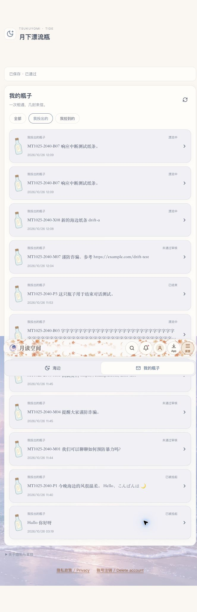

# 漂流瓶测试执行记录 · 2026-10-25

## 结论与范围

本轮 87 个用例逐项记录：**通过 70、部分覆盖 9、环境阻塞 7、发现问题 1**。通过项中包含接口补充验证，不等同于 87 项全部完成手动验收；这不是生产上线批准。

在本轮覆盖范围内，未观察到非参与者越权、待审正文送达他人、重复审核覆盖、同瓶多人领取，或关闭/屏蔽后继续回复。首次验收复现的丢响应重试重复投瓶，已在后续修复与自动复测中处理，见下一节。

- 时间：2026-10-25 20:40–21:20 PDT（页面时间使用其他时区）。
- 环境：[独立测试站](https://sb-47n2f9pzxumy.vercel.run)，Vercel Sandbox `drift-manual`，隔离 SQLite 数据库。
- 版本：功能提交 `71d69a6`（补签前为 `9d397c9`）加“统一管理页漂流瓶标签”变更；测试期间未改业务实现。
- 会话：Brave 普通 A、Brave 无痕 B、Safari 普通 R、Safari 无痕 G→C。C 为本轮创建的普通测试账号。
- 数据前缀：`MT1025-2040`；大数据及并发 fixture 使用 `MT1025-2040-API`。未操作测试前已有瓶子的结束、举报或屏蔽。
- 方法：UI 为实际界面操作；接口为沙箱内调用真实服务并复核数据库；大数据 fixture 直接在隔离库准备。基础接口脚本 **45/45** 断言通过，后续通知、公开输出、限流恢复另有证据。
- 依据：[手动测试清单](drift-bottles-manual-test.md)。真机、英文站、独立翻译服务未由视口模拟或接口检查替代。

## 后续修复与复测

下面的 87 项统计和截图保留首次验收时的历史结果。B07 重复投瓶及英文网络错误
已在本 PR 后续修复，不将原历史数据改写成新一轮全量验收。

- 投瓶与回信使用持久化提交回执，原样重试不重复写入、不重复通知；跨正文、语言、操作及瓶子的标识复用返回 409。
- 当前标签只存提交标识与摘要；刷新后重填相同原文仍复用标识，不持久化正文草稿。
- 网络错误有中/日/英文反馈；分别说明“结果未知，可能已保存”和“已保存但刷新失败，无需重发”。
- 旧库升级通过新增迁移 `056_create_drift_submissions`，保留原瓶子与回信。
- 自动复测：33 项 Node 回归、10 项翻译安全回归和 8 项 Chromium E2E 通过。浏览器真实中断已保存的响应后，投瓶（含刷新页面）与回信重试均只保存一次，回信通知只产生一次；读取失败及保存成功后刷新失败的本地化提示也通过。E2E 包含原有桌面/移动视口用户流程及管理页回归，使用本机缓存的 Chromium headless shell 1248。
- `npm run check`、中文与海外版前端构建通过。新增浏览器用例见 `tests/e2e/drift-retry.spec.js`；[提交结果未知的本地化截图](drift-test-evidence/2026-10-25/retry-result-unknown.png)。
- 原先英文双域、独立翻译、真机软键盘和其他部分覆盖项目仍保持原结论，未由此次自动测试替代。
- 2026-10-26 后续：真实双域、独立 Argos 翻译及键盘布局补测另见[新报告](drift-bottles-cross-domain-results-2026-10-26.md)，保留下表首次验收历史状态；真机尚待操作者反馈。

## 发现的问题（首次验收历史记录）

### 1. 丢失成功响应后重试会重复投瓶（B07）

复现：A 提交 `MT1025-2040-B07 响应中断测试纸条。`；在真实 POST 响应阶段观察到 **201** 后，中断该 Fetch 响应。UI 显示 `Failed to fetch` 并保留草稿。先返回列表确认已有一条，再重开草稿发送，最终出现两条相同内容，数据库 ID 为 **75、76**。

预期：同一次提交的重试能够识别原结果，或明确提示先核对结果。实际：没有幂等标识，二次发送创建第二条。本轮只复现投瓶；同类回信重试风险未单独重现。建议为提交增加稳定的请求标识及服务端去重，并覆盖丢响应后的重试测试。

### 2. 网络错误原样显示英文（B06/B07）

中文界面断网或中断响应时显示 `Failed to fetch`，缺少本地化和“可能已经保存，请先查看列表”的提示。草稿保留正确。建议区分未发出与提交结果未知，并给出核对入口。

[错误截图](drift-test-evidence/2026-10-25/lost-response.jpg)

## 逐项结果

“部分”行明确说明未覆盖分支；“环境阻塞”没有计入通过。UI＋接口表示两者共同提供证据，不表示接口动作是通过浏览器手动完成。

### 入口与登录

| 编号 | 结果 | 方法 | 观察与限制 |
| --- | --- | --- | --- |
| E01 | 部分 | UI | 访客直接链接显示登录门槛，无私人正文；未重跑访客的探索菜单路径。 |
| E02 | 通过 | UI | 从提示进入登录，A 登录后返回 /drift。 |
| E03 | 通过 | UI | 标签与 URL 同步；浏览器后退回海边、前进回我的瓶子。 |
| E04 | 通过 | UI | Safari R 显示统一内容管理五个标签。 |
| E05 | 通过 | UI | 旧 /admin/drift 跳转到 /admin?tab=drift，刷新保持。 |

### 投瓶与领取

| 编号 | 结果 | 方法 | 观察与限制 |
| --- | --- | --- | --- |
| F01 | 通过 | UI | 首屏只显示投/捡入口，点击才打开表单。 |
| F02 | 通过 | UI | 取消没有创建；同页重开保留草稿。 |
| F03 | 通过 | UI | A 的普通多语纸条 #4 自动通过，进入投出列表。 |
| F04 | 通过 | UI | 未领取 #9 显示等待，无回应和对方资料。 |
| F05 | 通过 | UI＋接口 | 本人未领取瓶子未匹配自己；空池显示“潮水还没带来新的瓶子”。 |
| F06 | 通过 | UI | B 领取 #4，先封瓶、点击打开才显示正文。 |
| F07 | 通过 | UI | B 列表可重开 #4，A 刷新显示已被捡起。 |
| F08 | 通过 | UI | A/B 全部、投出、捡到分类对应身份；C 捡到分类为空。 |
| F09 | 通过 | UI | 参与者直接链接和刷新可读；关闭移除 bottle 参数。 |
| F10 | 通过 | UI＋接口 | B 放回 #7 后旧链接不可读，列表移除。 |
| F11 | 通过 | UI | B 后续再次捡到并打开同一个 #7。 |
| F12 | 通过 | UI＋接口 | 已有回信显示收好；补充接口验证待审、拒绝回信均使放回返回 409。 |

### 回信与通知

| 编号 | 结果 | 方法 | 观察与限制 |
| --- | --- | --- | --- |
| L01 | 通过 | UI | B 普通回信成功，阅读视图显示本人来信。 |
| L02 | 通过 | UI | A/B 往返、原文和作者顺序正确，多行文字保留。 |
| L03 | 通过 | UI | 前台轮询和收取回信均能更新新信。 |
| L04 | 通过 | UI | 写草稿期间人工放行新信，草稿没有被覆盖或发送。 |
| L05 | 通过 | UI | 取消/关闭重开保留；#74 草稿在 #4 中为空，再回 #74 仍在。 |
| L06 | 通过 | UI | 收好、刷新、退出后重登 A，#4 原文及已提交回信仍在。 |
| L07 | 部分 | UI＋接口 | 通用通知标题、空正文与点击跳转通过；普通待审提交前后的通知基线未逐条独立计数。 |
| L08 | 部分 | UI | B 主页链接指向 drift-a，关注后关注数 0→1；未反向跑 A 关注 B。 |

### 瓶子审核

| 编号 | 结果 | 方法 | 观察与限制 |
| --- | --- | --- | --- |
| M01 | 通过 | UI | 关键词瓶 #5 待审，作者可读；R 显示“暴力”。 |
| M02 | 通过 | UI＋接口 | 待审 #5 对 B 返回不存在，未进入领取池。 |
| M03 | 通过 | UI | R 通过 #5 后，B 实际领取并读取。 |
| M04 | 通过 | UI＋接口 | 关键词瓶 #6 被拒，A 显示未通过；被拒状态不会进入池。 |
| M05 | 通过 | UI | 外链瓶 #7 待审，队列显示 example.com。 |
| M06 | 通过 | UI | 外链通过先取消、再确认；没有打开外部网页。 |
| M07 | 通过 | UI＋接口 | 组合瓶 #72 同时显示诈骗和 example.com，拒绝后作者状态正确。 |
| M08 | 通过 | UI | 普通文本自动通过；正面“谨防诈骗”仍命中规则待审。 |

### 回信审核

| 编号 | 结果 | 方法 | 观察与限制 |
| --- | --- | --- | --- |
| R01 | 通过 | UI＋接口 | 回信 #8 作者 B 可见待审，A 刷新/重开不可见。 |
| R02 | 通过 | UI | 队列显示回信 ID、所属瓶子 ID、作者、时间和原因。 |
| R03 | 通过 | UI | R 通过 #8，A 收到可见正文，B 不再待审。 |
| R04 | 部分 | UI | 组合回信 #9 被拒，B 看见拒绝、A 不见，后续可继续通信；拒绝前后通知数未单独取基线。 |
| R05 | 部分 | UI | 关键词＋外链回信已进入审核并拒绝；纯外链回信的通过确认分支未独立重跑。 |
| R06 | 通过 | UI＋接口 | #74 的待审回信 #124 在结束后通过，仍关闭、无回应；A 通知总数 4→4。 |

### 统一管理页

| 编号 | 结果 | 方法 | 观察与限制 |
| --- | --- | --- | --- |
| U01 | 通过 | UI | 文章/留言/图库/附件/漂流瓶依次可加载，URL 对应，样式统一。 |
| U02 | 部分 | UI | 前缀、正文片段、无匹配、清空均正确；未单独按作者 UUID 搜索。 |
| U03 | 通过 | UI＋接口 | 刷新读取新队列，处理后条目与数量更新，重复审核不能覆盖。 |
| U04 | 部分 | 接口 | 首次审核 200，重复改结果 409；未在两个真实管理标签重现旧条目的页面提示。 |
| U05 | 通过 | UI | 本轮队列清空后显示暂无待审核，没有附件库或海边控件。 |
| U06 | 通过 | UI | 专用 #60–71 共 12 条，10＋2 分页；末页删减到 10 后回到有效页。 |

### 权限与隐私

| 编号 | 结果 | 方法 | 观察与限制 |
| --- | --- | --- | --- |
| S01 | 通过 | 接口 | 未登录列表、详情、审核队列均 401。 |
| S02 | 通过 | UI＋接口 | A 管理页无权限；普通账号审核队列/审核写入 403。 |
| S03 | 通过 | UI＋接口 | 普通 C 访问真实 #4 页面/API 不存在，不含私人正文。 |
| S04 | 通过 | 接口 | C 对 #4 回信 403，关闭/举报/屏蔽/放回 404；原状态未改变。 |
| S05 | 通过 | 接口 | 详情 Cache-Control 含 private/no-store/no-cache；不含内部 review。 |
| S06 | 通过 | UI | 同一 Brave 从 A 退出再登录 C，旧 #4 链接不含 A 原文；恢复 A 后历史正常。 |
| S07 | 通过 | 接口 | 公开广场、A/B 主页、JSON/RSS 与 rss.xml 均 200，无本轮私人正文标记；messages 表无串入。 |
| S08 | 通过 | 接口 | R 非参与者直接读取 #4 仍为 404。 |

### 输入与网络

| 编号 | 结果 | 方法 | 观察与限制 |
| --- | --- | --- | --- |
| B01 | 通过 | UI＋接口 | 投瓶/回信空白禁用；服务端空内容与空格返回 422。 |
| B02 | 通过 | UI | #4 和回信 #123 中英日、多行与普通 emoji 原样可读。 |
| B03 | 通过 | UI＋接口 | 投瓶/回信 2001 字拒绝；普通键入受 maxlength 限制；#8 与回信 #122 恰好 2000 字成功。 |
| B04 | 通过 | UI＋接口 | 瓶子和回信 HTML、javascript: 均报验证错误；数据库无对应非法内容。 |
| B05 | 通过 | UI＋接口 | 双击瓶 #72 与回信 #121 各落库一次；审核接口重复执行 409。 |
| B06 | 通过 | UI＋接口 | Offline 报错且保留草稿，在线重试只落库一次；错误文案未中文化，见问题 2。 |
| B07 | 发现问题 | UI＋接口 | 服务端 201 响应被中断后报错；重试实际新增第二瓶，#75/#76 文本完全相同。 |
| B08 | 部分 | UI | 多次切标签和先后打开不同瓶子未串内容；未控制两个迟到详情响应逆序到达。 |
| B09 | 通过 | UI | 刷新后启动遮罩消失可操作，实际管理页为五标签。 |

### 屏幕、键盘与语言

| 编号 | 结果 | 方法 | 观察与限制 |
| --- | --- | --- | --- |
| V01 | 通过 | 桌面＋视口模拟 | 390×844 投瓶成功、领取 #74 成功，390×420 回信成功；无横向溢出，按钮可命中。不是实体手机验证。 |
| V02 | 环境阻塞 | — | 仅模拟缩小视口，未连接实体手机，不能确认原生软键盘及旋转。 |
| V03 | 通过 | UI | 方向键、Home/End、Tab→投瓶按钮、Enter 和 Esc 正确，焦点有 2px 实线。 |
| V04 | 通过 | UI | 用户纸条和审核页浅/深色可读，待审/拒绝有文字；已恢复浅色。 |
| V05 | 部分 | UI | 中/日切换后界面改变、原文不变，已恢复中文；本域没有英文切换，未部署英文构建。 |

### 翻译与跨站

| 编号 | 结果 | 方法 | 观察与限制 |
| --- | --- | --- | --- |
| T01 | 环境阻塞 | — | 当前中文沙箱没有英文构建与独立私密翻译服务。 |
| T02 | 环境阻塞 | — | 缺少可用的私密翻译服务，未验证请求范围和译文清除。 |
| T03 | 环境阻塞 | — | 没有独立翻译服务可执行错误分支。 |
| T04 | 环境阻塞 | — | 没有测试翻译后端及缓存/日志配置可审计。 |
| T05 | 环境阻塞 | — | 没有第二个英文测试域名连接同一隔离 API。 |
| T06 | 环境阻塞 | — | 单域 /api/drift 权限已验证，双域 Cookie 和公开路径隔离仍需第二站。 |

### 数据量、并发与限流

| 编号 | 结果 | 方法 | 观察与限制 |
| --- | --- | --- | --- |
| D01 | 通过 | UI＋接口 | C 首批 30 条，继续加载到 44 条无重复；API 30＋2 游标页不相交。 |
| D02 | 通过 | UI＋接口 | 105 封样本只见最近 100 封，编号 006–105 正序。 |
| D03 | 通过 | 接口 | 隔离两名普通领取者并发请求同一瓶 #15，只有一方获得该 ID。 |
| D04 | 通过 | UI＋接口 | 第 13 次写入 429，Retry-After=600；窗口后 201；真实 UI 429 有提示且保留草稿。 |
| D05 | 通过 | 接口 | 第 31 次捡瓶 429，Retry-After=600；窗口后恢复 200。 |

### 结束、举报与屏蔽

| 编号 | 结果 | 方法 | 观察与限制 |
| --- | --- | --- | --- |
| X01 | 通过 | UI | 未领取 #9 与已领取 #74 的结束确认先取消，状态和回应能力保留。 |
| X02 | 通过 | UI＋接口 | 确认结束 #74 后保留历史无回应；补充关闭样本双方详情 200、回信 403、放回被拒。 |
| X03 | 通过 | UI | 作者结束未领取 #9，列表显示已结束。 |
| X04 | 通过 | UI＋接口 | #7 举报先取消再确认；确认后隔离，R 显示用户举报/原对话关闭。 |
| X05 | 通过 | UI | R 放行举报 #7 后，B 可读历史但仍关闭，无回应或放回。 |
| X06 | 通过 | UI＋接口 | 独立 #5 举报后被拒，作者显示拒绝，B 旧链接不存在，closed=1。 |
| X07 | 通过 | UI | B 屏蔽 A 先取消再确认；双方保留历史且回应消失。 |
| X08 | 通过 | UI＋接口 | 实际 A/B 双向回复 403；各投 #73/#74 后双方匹配为空；结束后已清理本轮屏蔽关系。 |
| X09 | 通过 | UI＋接口 | 屏蔽后 R 放行 #121，B 可见历史但无法回应；B 通知总数 5→5。 |

## 关键证据与测试后状态

- [接口基础断言](drift-test-evidence/2026-10-25/api-results.json)：45/45。
- [实际 A/B 屏蔽与通知计数](drift-test-evidence/2026-10-25/final-results.json)：双向 403、匹配空、通知 5→5；双击各存一条。
- [公开输出及窗口恢复](drift-test-evidence/2026-10-25/audit-results.json)：六个公开入口无私人标记、2000 字回信成功、重复瓶 ID、窗口后恢复。
- UI 截图：[五标签空队列](drift-test-evidence/2026-10-25/admin-final.jpg)、[手机回信](drift-test-evidence/2026-10-25/mobile.jpg)、[手机投瓶](drift-test-evidence/2026-10-25/mobile-throw.jpg)、[普通用户无管理权限](drift-test-evidence/2026-10-25/permission.jpg)、[长历史](drift-test-evidence/2026-10-25/history.jpg)、[结束后审核通过](drift-test-evidence/2026-10-25/closed-approved.jpg)、[屏蔽后审核通过](drift-test-evidence/2026-10-25/block-approved.jpg)、[日文原文](drift-test-evidence/2026-10-25/ja.jpg)。
- #74 / 回信 #124 的 UI＋数据库后验：`closed=1`、`status=approved`、A 通知总数审核前后均为 4。
- 本轮新增的 B→A 屏蔽关系已移除，#4 仍可正常通信；结束/举报样本保持其验收状态。关注关系与测试内容保留，供人工回看，没有批量删除旧数据。
- 网络 Offline、Fetch 响应拦截、临时视口均已清除，界面恢复中文浅色；没有保存测试账号密码。
- 沙箱测试中一次因运行时限停止，恢复服务后原数据仍在；这不计为业务数据丢失。当前仍有单次 45 分钟的环境时限。

后续验收优先补齐双管理标签的冲突提示、纯外链回信通过分支、通知独立计数、乱序网络响应，以及英文/翻译双域和实体手机软键盘。B07 已有后续自动复测；独立沙箱如仍运行旧构建，需要部署本次修复并执行迁移后才能验证新行为。
