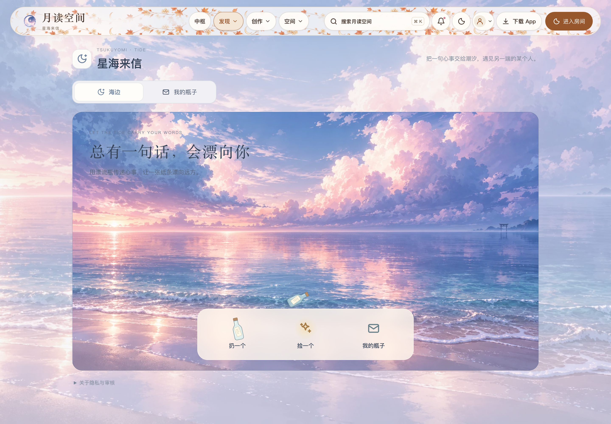
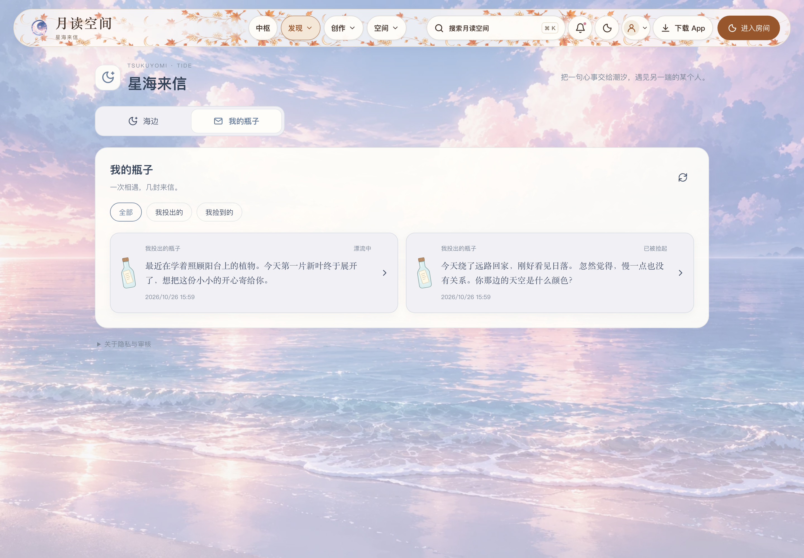
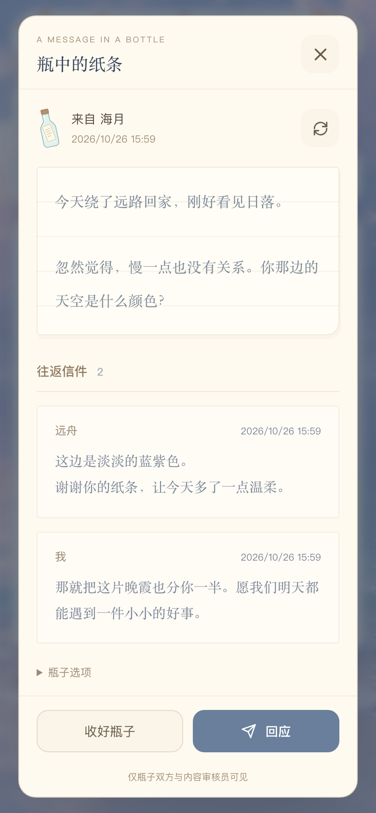
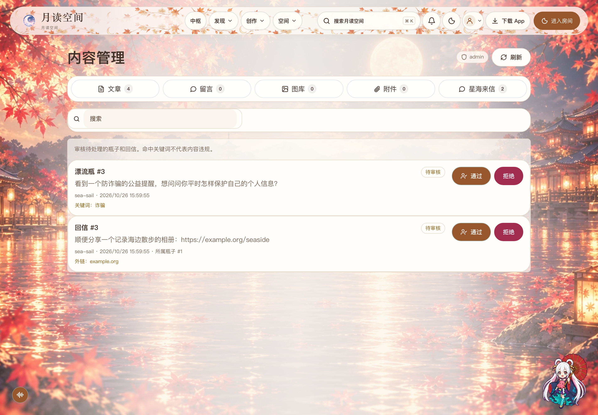

# 星海来信界面展示

截图来自本分支的真实界面，使用隔离本机 API、SQLite 数据库和合成账号（海月、远舟）。没有使用真实用户的私密正文。图中时间由应用正常显示。

这些图片用于介绍功能，不作为历史手动测试或实体手机的验收证据。历史结果和接口记录仍保留在测试报告中。

## 海边 · 桌面

1440 × 1000 CSS 像素，浅色主题；页面名、简介与漂流瓶玩法说明。

## 我的瓶子 · 桌面

已领取的往来纸条与仍在海上漂流的瓶子。

## 纸条往来 · 手机视口

390 × 844 CSS 像素，展示原文、两封回信及回应入口；这是浏览器视口截图。

## 内容管理 · 桌面

同一管理页面的“星海来信”标签，展示关键词和外链待审项。示例域名使用 `example.org`；命中关键词不代表违规。

